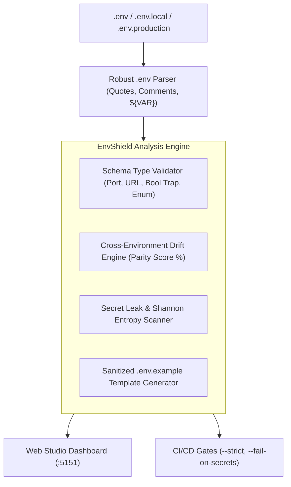

# 🛡️ EnvShield

> **Developer-First Environment Variable Linter, Secret Leak Detector, Schema Type Validator & Visual Drift Studio.**  
> Crafted by **[Jatin Sharma](https://jatinsh.netlify.app/)** • GitHub: **[@raghav1924](https://github.com/raghav1924)**

[](https://opensource.org/licenses/MIT)
[](https://github.com/raghav1924/envshield/actions)
[](https://nodejs.org/)
[](https://www.typescriptlang.org/)
[](https://github.com/raghav1924/envshield)
[](https://jatinsh.netlify.app/)

---

## 🌟 Why EnvShield?

In modern microservices, full-stack monorepos, and cloud deployments, environment variables configure runtime behavior, database connections, and third-party integrations. However, environment configuration is a major source of production outages:
- **Environment Drift:** Developers update `.env.local` or `.env.example`, but variables are missing in staging or production, triggering fatal deployment crashes.
- **Silent Type & Boolean Traps:** An environment variable `ENABLE_BETA="false"` is evaluated as truthy in JavaScript (`Boolean("false") === true`), or invalid port numbers (`PORT="abc"`) cause unhandled server crashes.
- **Committed Secrets in Git:** Live Stripe keys (`sk_live_...`), AWS credentials (`AKIA...`), and OpenAI keys accidentally committed in plaintext.
- **Outdated Example Files:** `.env.example` templates lag behind codebases by months.

**EnvShield** solves this with a lightweight, zero-dependency static analysis engine and dark-mode visual studio:
- 🔍 **Strict Type & Schema Validation:** Enforce port ranges (`1-65535`), numeric types, URLs, emails, enums, and flag dangerous `"false"` boolean traps.
- 📉 **Multi-Environment Drift Engine:** Compare `.env.example` against `.env.production` or `.env.local` to calculate parity percentage and flag missing variables.
- 🚨 **Secret Leak & Shannon Entropy Scanner:** Scan files for AWS, Stripe, GitHub, OpenAI, Slack tokens, private keys, and high-entropy ($H \ge 4.5$) random credentials.
- 📝 **Sanitized Template Generator:** Auto-synthesize clean `.env.example` templates with smart masked placeholders.
- 🎨 **Dark-Mode Visual Studio:** Explore cross-environment drift matrices, secret leak audits, and schema linters on `http://localhost:5151`.
- ⚡ **Zero External Dependencies:** Built with pure TypeScript on Node.js standard libraries (`node:fs`, `node:path`, `node:http`, `node:crypto`).
- ⚡ **Blazing Fast Performance:** Benchmarks show 200,000+ lines/sec parsing and sub-50ms Shannon entropy scans. See [ARCHITECTURE.md](ARCHITECTURE.md), [docs/RECIPES.md](docs/RECIPES.md), [docs/CHEATSHEET.md](docs/CHEATSHEET.md), and [docs/MULTI_TENANT_GUIDE.md](docs/MULTI_TENANT_GUIDE.md) for details.

---

## 🏗️ Architecture Overview



---

## 🚀 Quickstart

### 1. Build and Run
```bash
# Clone the repository
git clone https://github.com/raghav1924/envshield.git
cd envshield

# Compile TypeScript
npm run build

# Run unit tests
npm test
```

### 2. Available CLI Commands
```bash
# Validate .env.local against strict schema
./dist/bin.js check examples/.env.local --schema examples/env.schema.json

# Detect drift between baseline and production
./dist/bin.js drift examples/.env.example examples/.env.production

# Scan environment files for committed plaintext secrets
./dist/bin.js scan examples/.env.production --fail-on-secrets

# Generate a sanitized .env.example template
./dist/bin.js generate examples/.env.local --out .env.example

# Launch interactive dark-mode Web Studio
./dist/bin.js studio examples/ --port 5151
```

---

## 🧪 Schema Validation Rules

| Rule | Description | Detection |
|---|---|---|
| `port` | Validates integer in range 1 - 65535 | `PORT=999999` ➜ Critical Error |
| `boolean` | Verifies `"true"` / `"false"` and flags JS `Boolean("false")` trap | `DEBUG="false"` ➜ Coercion Warning |
| `url` | Ensures valid URL structure and protocol | `APP_URL="invalid_url"` ➜ Critical Error |
| `email` | Validates RFC-compliant email address | `ADMIN_EMAIL="admin@"` ➜ Critical Error |
| `enum` | Enforces membership in allowed values array | `NODE_ENV="qa"` ➜ Enum Violation |
| `secret` | Flags dummy insecure placeholders (`password`, `change_me`) | `JWT_SECRET="password"` ➜ Critical Error |

---

## 🎨 Interactive Dark-Mode Web Studio

When you launch `envshield studio`, open `http://localhost:5151` in your browser:
- **Cross-Environment Drift Matrix:** Compare `.env.example`, `.env.local`, and `.env.production` side-by-side with color-coded missing/extra indicators.
- **Secret Leak Audit:** View detected credentials with masked previews, Shannon entropy metrics, and remediation instructions.
- **Type & Schema Linter:** Real-time violation list with recommended snippets.

---

## 👨‍💻 Author

**Jatin Sharma**  
- Portfolio: **[https://jatinsh.netlify.app/](https://jatinsh.netlify.app/)**  
- GitHub: **[@raghav1924](https://github.com/raghav1924)**  
- Email: [raghavjatin245@gmail.com](mailto:raghavjatin245@gmail.com)

---

## 📄 License

Licensed under the **MIT License** — see [LICENSE](LICENSE) for details.

